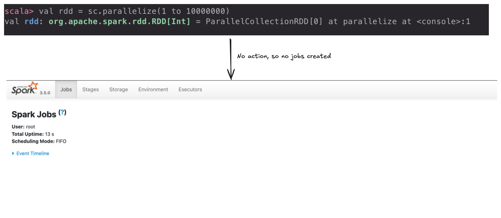
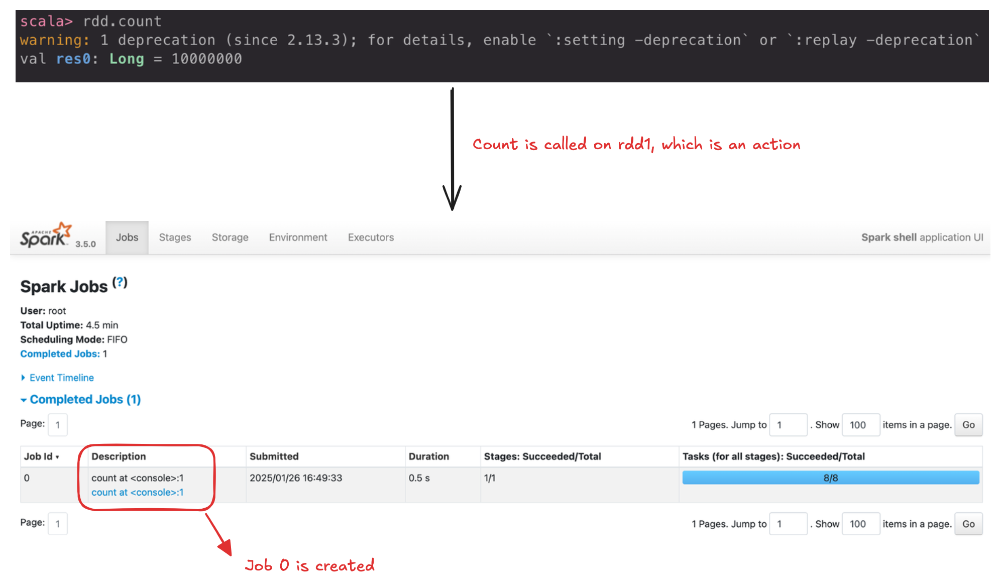
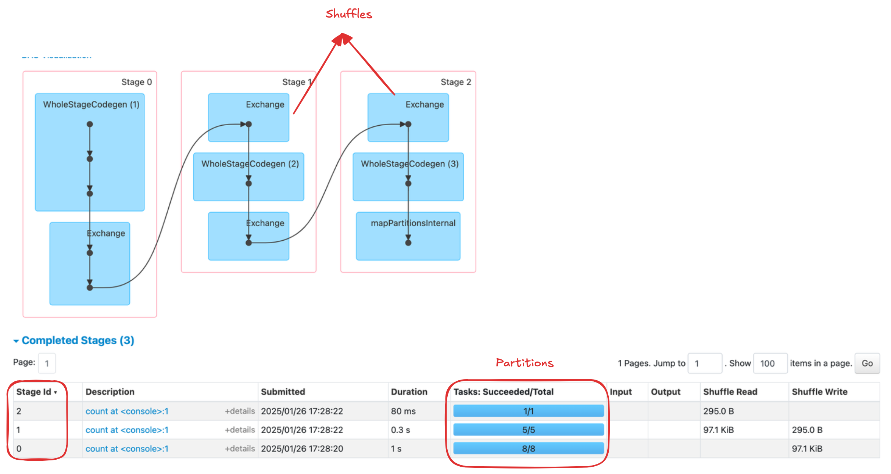
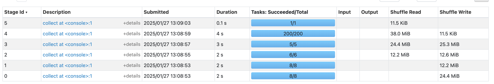
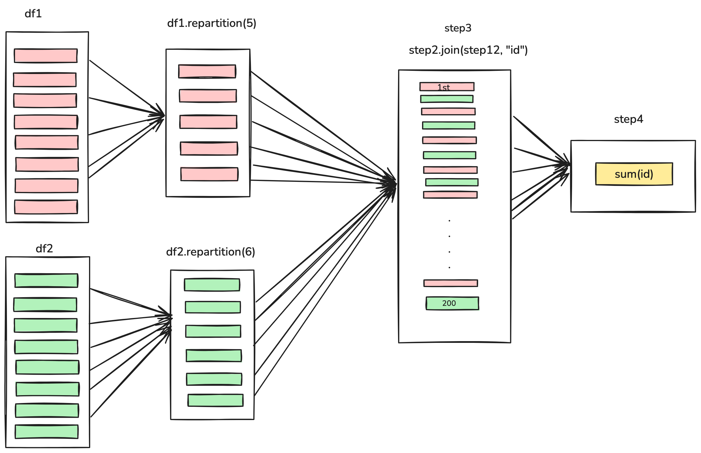

Here's a small Spark program: two DataFrames, one repartitioned into 5 partitions and the other into 6, joined and summed. Open the Spark UI and one of its stages has **200 tasks**. Nothing in the code says 200.

Where that number comes from is the key to reading the Spark UI:

> One action creates a job. Every shuffle starts a new stage. Every partition becomes a task.

This post walks through each of those three rules with the Spark UI open, and ends with where the 200 came from.

<!-- truncate -->

## Every Action Creates a Job

Each application is made up of one or more Spark jobs, and a job is created for <Highlight color="#3e6980">each action</Highlight> (`count`, `collect`, `write`, …). Jobs triggered from the same thread run one after another. They only run in parallel if you submit them from separate threads.

Since Spark [evaluates lazily](https://en.wikipedia.org/wiki/Lazy_evaluation), transformations alone do nothing. If there are no actions, there are no jobs:



Call an action on the DataFrame, and a job appears:



Each job breaks down into a series of stages, and the number of stages depends on how many shuffles the job needs.

## Every Shuffle Starts a New Stage

A stage is a group of tasks that Spark can run together to perform the same operation across multiple machines. Spark tries to fit as much work as possible into one stage, but it has to start a new one whenever there's a shuffle.

A shuffle happens when <Highlight color="#3e6980">Spark redistributes data across partitions or nodes in the cluster</Highlight>. Sorting a DataFrame, or grouping by key (which sends all records with the same key to the same node), both need one. Data physically moves between executors, so everything before the shuffle has to finish before anything after it can start. That boundary is the stage boundary.

```
scala> val df1 = spark.range(2, 10000000, 2)
val df1: org.apache.spark.sql.Dataset[Long] = [id: bigint]

scala> val step1 = df1.repartition(5)
val step1: org.apache.spark.sql.Dataset[Long] = [id: bigint]

scala> step1.count()
val res0: Long = 4999999
```



One action (`count`), so one job, split into three stages:

- **Stage 0** is the `range` that creates the DataFrame. On this machine, `range` produced `8 partitions` by default.
- **Stage 1** is the `repartition`. It shuffles the data into `5 partitions`.
- **Stage 2** is the `count` itself.

Now the program from the start of this post:

```scala
val df1 = spark.range(2, 10000000, 2)
val df2 = spark.range(2, 10000000, 4)
val step1 = df1.repartition(5)
val step12 = df2.repartition(6)
val step2 = step1.selectExpr("id * 5 as id")
val step3 = step2.join(step12, ["id"])
val step4 = step3.selectExpr("sum(id)")
```





Stages 3 and 4 work on each DataFrame separately, and each ends at the join, which is another shuffle. The stage after the join is the one with 200 tasks.

## Every Partition Becomes a Task

A task is a <Highlight color="#3e6980">unit of computation applied to a unit of data (the partition)</Highlight>. Each task runs a stage's transformations on one partition, on a single executor. So a stage has exactly as many tasks as its data has partitions.

That's where the 200 comes from. When a DataFrame shuffle happens, the number of output partitions isn't taken from your input; it's taken from `spark.sql.shuffle.partitions`, which **defaults to 200**. The join shuffled both sides into 200 partitions, so the next stage ran 200 tasks, whether the data needed them or not.

You can change it:

```scala
spark.conf.set("spark.sql.shuffle.partitions", 50)
```

:::note
A good rule of thumb: the number of partitions should be larger than the number of executor cores on your cluster, often by a few times, so every core has work. On a small dataset, 200 tiny partitions is mostly overhead.
:::

## The Whole Picture in One Table

| **Topic**                 | **Key Points**                                                                                                                                                                          |
|---------------------------|-----------------------------------------------------------------------------------------------------------------------------------------------------------------------------------------|
| **App Decomposition**     | - 1 Spark Application can have 1 or more Jobs. <br/> - Each Job is broken into 1 or more Stages.                                                                                       |
| **Stages & Tasks**        | - Each Stage is subdivided into Tasks. <br/> - Shuffle boundaries (data rearrangements) define when Spark moves from one Stage to the next.                                            |
| **Tasks & Executors**     | - One Task runs on one Executor (it can’t move mid-task). <br/> - An Executor can run multiple Tasks (depending on its available cores).                                                |
| **Partitions & Tasks**    | - Processing one partition = one Task. <br/> - The number of Tasks in a Stage often equals the number of partitions for that data.                                                     |
| **Partitions & Executors**| - A partition stays on one Executor while it’s being processed. <br/> - Each Executor can hold 0 or more partitions in memory or on disk.                                              |
| **Executors & Nodes**     | - 1 Executor corresponds to 1 JVM running on 1 physical/virtual Node. <br/> - Each Node can host 0 or more Executors.                                                                   |

Or in one line: **Application → Jobs → Stages → Tasks**, where each task processes one partition on one executor.

## References

1. [Spark: The Definitive Guide](https://www.amazon.com/Spark-Definitive-Guide-Processing-Simple/dp/1491912219)
2. [Apache Spark Documentation](https://spark.apache.org/docs/latest/index.html)

The next time the Spark UI shows a number you didn't write, look for the shuffle before it. That's where the 200 came from.

More in the [Apache Spark](/blog/tags/apache-spark) series.
