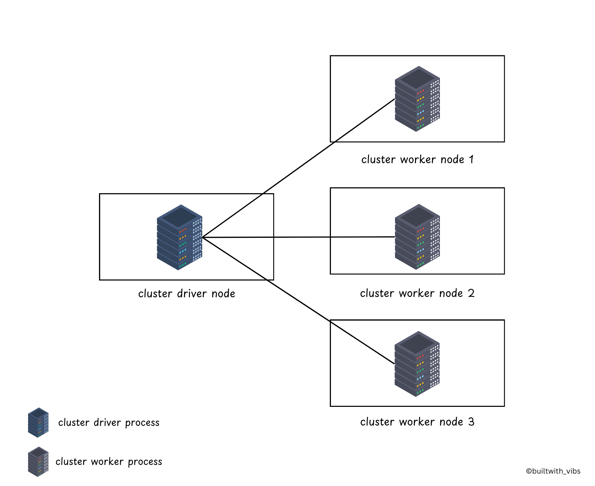
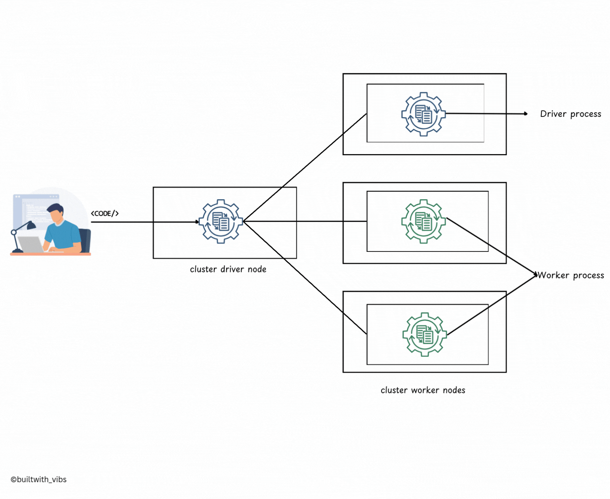
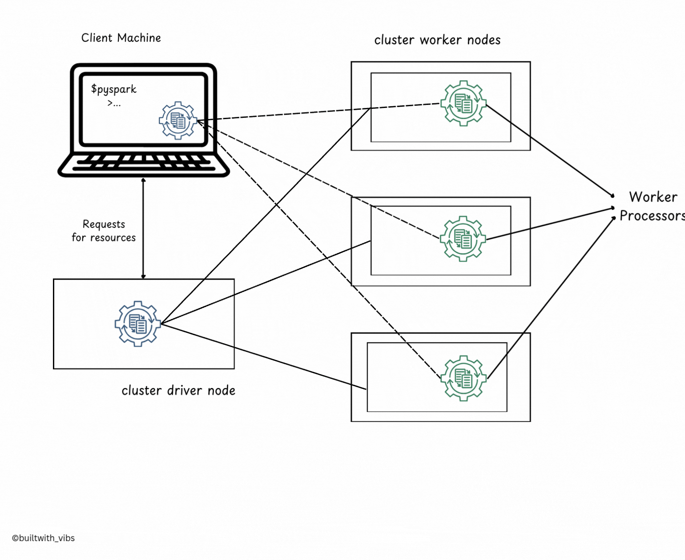

Submit a Spark job from your laptop, close the lid, and the job dies. Submit the same job with one flag changed, `--deploy-mode cluster`, close the lid, and it keeps running.

Nothing about the code changed. What changed is where one process, the **driver**, runs.

> An execution mode decides one thing: where the driver lives.

Spark has three modes: cluster, client and local. This post covers the three processes behind every Spark application, then what each mode does with them.

<!--truncate-->

## Three Processes Run Every Spark Application

1. **The Spark Driver**
    - The driver is the <Highlight color="#3e6980">controller of the execution</Highlight>. It keeps track of the application's state: which executors exist and which tasks they're running.
    - It asks the cluster manager for resources and schedules tasks on the executors.
    - It's just a process on a machine. If that process dies, the whole application dies with it.
2. **The Spark Executors**
    - Executors are <Highlight color="#3e6980">the processes that run the actual tasks</Highlight>, as assigned by the driver.
    - Each executor takes tasks from the driver, runs them, and reports their status and results back.
3. **The Cluster Manager**
    - The cluster manager <Highlight color="#3e6980">maintains the cluster of machines</Highlight> that will run your Spark application(s), for example YARN or Kubernetes.
    - Somewhat confusingly, a cluster manager has its own "driver" (sometimes called master) and "worker" abstractions.
    - The difference is that these are tied to physical machines, not processes as they are in Spark.



### Think of It as a Restaurant Kitchen

1. **Spark Driver (Head Chef)**: manages the kitchen, assigns tasks to the cooks, and makes sure every dish is prepared correctly.
2. **Spark Executors (Cooks)**: prepare the dishes following the head chef's instructions and report back when each one is ready.
3. **Cluster Manager (Restaurant Manager)**: makes sure the kitchen has enough staff, ingredients and equipment, and handles several kitchens' orders at once.

The execution mode answers one question: is the head chef standing in the kitchen, or giving instructions over the phone from home?

## Cluster Mode: The Driver Lives Inside the Cluster

```bash
spark-submit --deploy-mode cluster ...
```

1. You submit a JAR or Python script to the cluster manager.
2. The cluster manager launches both the driver and the executors on worker nodes inside the cluster.
3. The driver runs on one worker node; executors run on others.
4. The cluster manager manages and monitors all of the application's processes.



Once the job is submitted, your machine is no longer involved. Close the laptop, lose the VPN, and the job carries on.

## Client Mode: The Driver Lives on Your Machine

```bash
spark-submit --deploy-mode client ...
```

1. The driver runs on the machine that submitted the application, often called a **gateway machine** or **edge node**.
2. The cluster manager still launches the executors on worker nodes inside the cluster.
3. The driver talks to those executors over the network from outside the cluster.



This is what makes interactive work possible: `spark-shell` and notebooks run in client mode, so results come straight back to your screen. It's also why the job dies with your laptop: the driver was running on it.

## Local Mode: Everything Runs on One Machine

```bash
spark-submit --master "local[*]" ...
```

1. The driver and the executors all run in a single process on one machine.
2. Parallelism comes from threads (`local[*]` uses one per core), not from multiple nodes.
3. No cluster manager is needed.
4. It's for learning, testing and quick experiments on small data, not for production.

## Client vs Cluster at a Glance

|                            | **Client Mode**                          | **Cluster Mode**                       |
|-----------------------------|------------------------------------------|----------------------------------------|
| **Driver runs on**          | The submitting machine                   | A worker node in the cluster           |
| **Best for**                | Interactive use (development, debugging) | Production jobs, large-scale deployments |
| **Latency**                 | Lower latency for small tasks            | Slightly higher due to internal resource allocation |
| **Example Use Case**        | Testing and interactive Spark shells     | Scheduled batch jobs or long-running Spark applications |
| **Advantages**              | Easier to debug and monitor from client machine | More reliable and scalable for production workloads |
| **Disadvantages**           | The job dies if the client machine disconnects | More setup needed, harder to debug directly |

If your job has to outlive your terminal session, it needs cluster mode. If you want to see results as you type, it needs client mode.

To follow a Spark application from `spark-submit` to shutdown, read [The Life Cycle of a Spark Application](/blog/spark-application-lifecycle-outside). More in the [Apache Spark](/blog/tags/apache-spark) series.
