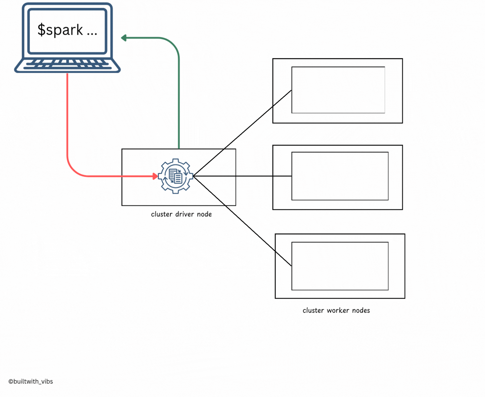
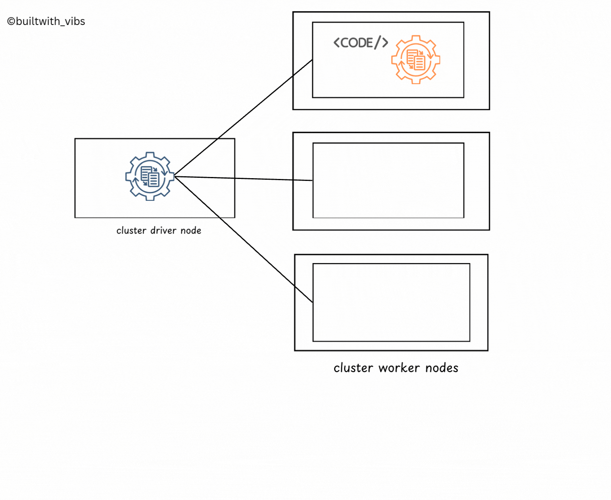
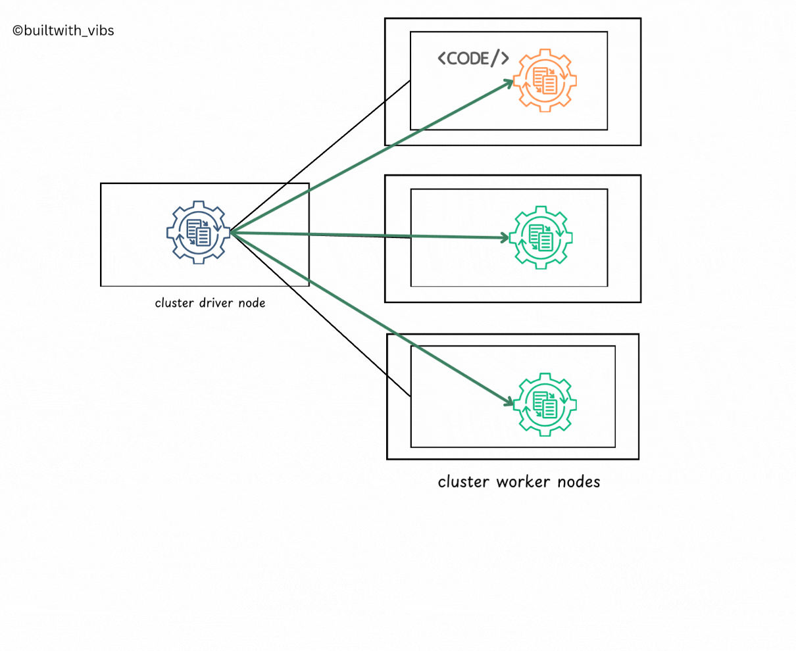
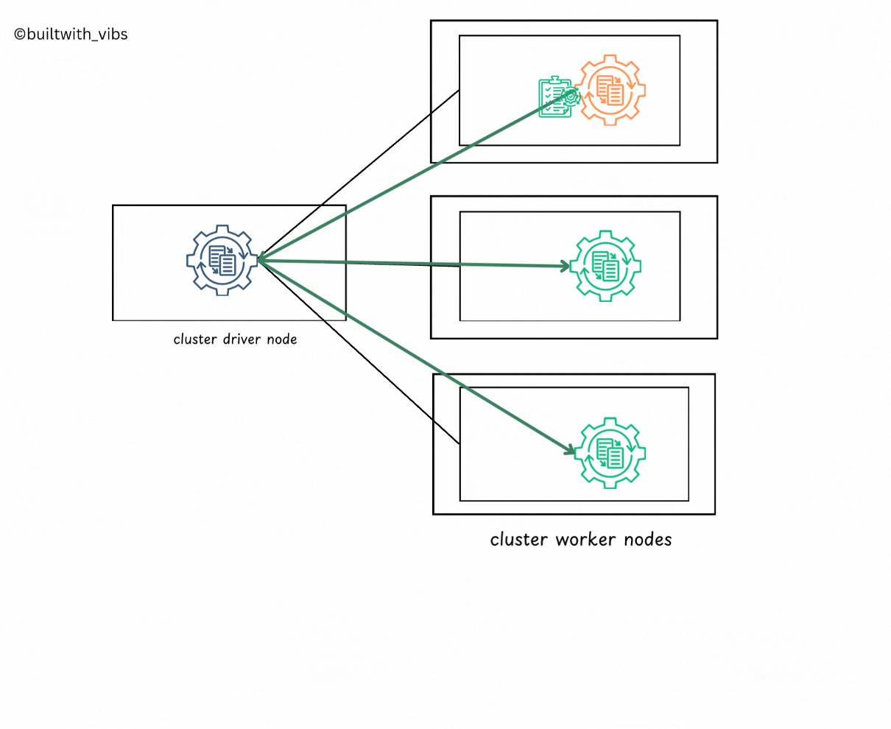

You type `spark-submit`, press enter, and some time later the result shows up. Your code ran somewhere in the middle of that, but most of what happened wasn't your code at all.

> Before your first line of Spark code runs, a driver has to be placed, executors have to be requested, and a cluster has to agree to give them to you.

This post follows a Spark application from the outside, in four steps: the request, the launch, the execution and the completion. It assumes **cluster mode**, where the driver runs inside the cluster; if that's new, read [Spark Execution Modes](/blog/spark-execution-modes) first.

<!-- truncate -->

## 1. The Request: spark-submit Asks for a Driver

Everything starts on your machine. `spark-submit` packages up what to run and sends a request to the **cluster manager** (YARN, Kubernetes, or Spark's standalone master): "please start a driver for this application".



```
./bin/spark-submit \
  --class <main-class> \
  --master <master-url> \
  --deploy-mode cluster \
  --conf <key>=<value> \
  ... # other options
  <application-jar> \
  [application-arguments]
```

The arguments describe the application, not the work:

- `--class`: the main class of the application
- `--master`: which cluster manager to talk to (`yarn`, `k8s://…`, `spark://…`, or `local` for no cluster)
- `--deploy-mode`: where the driver runs, `cluster` or `client`
- `--conf`: configuration such as executor count, memory and cores
- the application JAR (or Python file) and its arguments

At this point no Spark code has run. Your machine has only asked for a driver.

## 2. The Launch: The Driver Asks for Executors

The cluster manager starts the driver process on one of the cluster's nodes, and the driver starts running your code.

One of the first things your code does is create a `SparkSession`. That's the moment the driver turns to the cluster manager again, this time asking for **executors**, with the number, memory and cores you passed to `spark-submit`. The cluster manager launches the executor processes across the cluster and tells the driver where they are.



Now there's a driver and a set of executors, and the application finally has somewhere to run.

## 3. Execution: The Driver Schedules, Executors Report Back

With executors running, the driver goes through your code. Each action becomes a job, each job is split into stages and tasks (see [Under the hood of a Spark job](/blog/spark-job-anatomy)), and the driver sends those tasks to the executors.

The executors run them, move data between each other when a shuffle needs it, and report each task's success or failure back to the driver. The cluster manager isn't involved here at all: it only hands out resources.



## 4. Completion: The Cluster Manager Cleans Up

When your code finishes, the driver exits with either success or failure. The cluster manager then shuts down the executors that belonged to that driver and frees their resources for the next application.



To find out whether the application succeeded, ask the cluster manager (for example, the YARN ResourceManager UI), not your terminal: in cluster mode, your machine stopped being involved after step 1.

## The Whole Trip

| Step | Who acts | What happens |
| --- | --- | --- |
| Request | Your machine → cluster manager | `spark-submit` asks for a driver |
| Launch | Driver → cluster manager | `SparkSession` asks for executors |
| Execution | Driver ↔ executors | Tasks are scheduled, run and reported |
| Completion | Cluster manager | Executors are shut down and resources freed |

So when a job is "slow to start", it might not be your code at all. It might still be at step 1 or 2, waiting for the cluster to hand over a driver or executors.

More in the [Apache Spark](/blog/tags/apache-spark) series.
