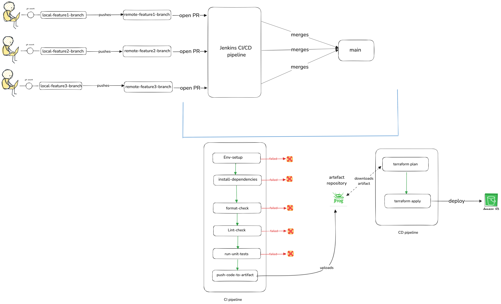

Most AWS Glue and Lambda code gets tested the same way: deploy it, run the job, and read the CloudWatch logs. Every fix means another deploy and another wait, and the only bugs you catch are the ones that happened to show up in that run.

The logic inside those jobs (cleaning a name, parsing a record, deciding where a file goes) doesn't need AWS to be tested. It's plain Python.

> Test the logic before it reaches AWS, and let the pipeline refuse to ship anything that fails.

As a data engineer, I've set up Jenkins pipelines that do exactly this. This post walks through one end to end: `uv` and `pyproject.toml` for dependencies, `ruff` for formatting and linting, `pytest` and `moto` for tests, `JFrog Artifactory` for build artifacts, and `Terraform` to deploy the tested code to S3 for Glue or Lambda to run.

:::tldr
**Problem:** Glue and Lambda code is often only tested by deploying it, so bugs are found late and slowly.

**Fix:** keep business logic in plain Python modules, test it with `pytest` (and AWS calls with `moto`) on every pull request, and only let CD deploy the exact artifact that passed.
:::

## The Pipeline: CI Checks the Code, CD Ships It

### Continuous Integration (CI)

Triggered on each commit or pull request, CI runs:

1. **Set Up the Environment**: install `uv` and sync dependencies from `pyproject.toml`.
2. **Code Quality Checks**:
   1. **Formatting**: `uv run ruff format --check` fails if any file isn't formatted.
   2. **Linting**: `uv run ruff check .` catches syntax issues, unused imports and common errors.
   3. **Import Sorting**: `uv run ruff check --select I` enforces import order.
3. **Unit Testing**: `uv run pytest`, producing JUnit reports.
4. **Artifact Packaging**: zip the tested code and upload it to JFrog Artifactory.

:::tip

Run the formatter before the linter. A lot of lint errors are formatting issues, and the formatter fixes those for free. You will thank me later ;)

:::

### Continuous Deployment (CD)

Once CI passes, CD deploys:

1. **Artifact Download**: fetch the build that CI just tested from Artifactory.
2. **Terraform Plan**: preview the infrastructure changes.
3. **Terraform Apply**: apply them.
4. **Trigger Execution**: Glue or Lambda jobs pick up the new code from `S3`.



The important part is that CD never rebuilds anything. It deploys the exact zip that passed the tests.

---

## Step 1: Keep AWS Out of Your Business Logic

Code is only easy to test if the logic doesn't depend on AWS. Keep the handler thin, and put the real work in modules that take plain data and return plain data.

**Python Code Structure**

```bash
data-pipeline/
├── pyproject.toml
├── Jenkinsfile
├── src/
│   ├── __init__.py
│   ├── handler.py         # Lambda handler logic
│   ├── transform.py       # Glue transformations or shared business logic
├── tests/
│   ├── __init__.py
│   ├── test_handler.py
│   └── test_transform.py
├── scripts/
│   └── deploy.sh          # Optional scripts for local testing or deployment
└── README.md
```

**Glue Example**

```python

# transform.py
def clean_name(data):
    return [{"name": item["name"].strip().lower()} for item in data]

```

---

## Step 2: Test Logic with pytest, and AWS Calls with moto

**Basic Unit Test with Pytest**

```python
from transform import clean_name

def test_clean_name():
    input_data = [{"name": " John "}]
    expected_output = [{"name": "john"}]
    assert clean_name(input_data) == expected_output
```

Run locally:

```bash
uv run pytest tests/
```

This runs in milliseconds on your laptop, with no AWS account involved.

**Mocking AWS Services with Moto**

For the code that does talk to AWS, `moto` fakes the AWS API in memory, so tests never touch a real bucket:

```python

from moto import mock_aws
import boto3

@mock_aws
def test_s3_upload():
    s3 = boto3.client('s3', region_name='us-east-1')
    s3.create_bucket(Bucket='test-bucket')
    s3.put_object(Bucket='test-bucket', Key='file.txt', Body='test')
    response = s3.get_object(Bucket='test-bucket', Key='file.txt')
    assert response['Body'].read().decode() == 'test'

```

**Sample pyproject.toml for Dependency Management**

```toml

[project]
name = "data-pipeline"
version = "0.1.0"
dependencies = [
    "boto3",
]

[dependency-groups]
dev = [
    "pytest",
    "moto",
    "ruff",
]

[tool.ruff]
line-length = 88
exclude = [".venv", "build"]

[tool.ruff.lint]
select = ["E", "F", "I", "UP"]

```

Test tools go in the `dev` group so they're installed in CI (`uv sync` includes it by default) but aren't part of what your job needs at runtime.

---

## Step 3: CI Runs Format, Lint, Test, Package

**CI Jenkinsfile using uv**

```groovy
pipeline {
    agent any
    stages {
        stage('Setup Env') {
            steps { sh 'curl -Ls https://astral.sh/uv/install.sh | sh' }
        }
        stage('Install Deps') {
            steps { sh 'uv sync' }
        }
        stage('Format') {
            steps { sh 'uv run ruff format --check' }
        }
        stage('Lint') {
            steps { sh 'uv run ruff check .' }
        }
        stage('Unit Tests') {
            steps { sh 'uv run pytest' }
        }
        stage('Publish Artifact') {
            steps {
                sh 'zip -r my_code.zip src pyproject.toml'
                sh 'curl -u $JFROG_USER:$JFROG_PASSWORD -T my_code.zip https://your-jfrog-url/artifactory/repo-name/'
            }
        }
    }
}
```

Every stage is a gate. If formatting, linting or a single test fails, the pipeline stops and nothing is published.

---

## Step 4: CD Deploys What CI Built, with Terraform

**CD Jenkinsfile**

```groovy

pipeline {
    agent any
    environment {
        TF_VAR_code_url = 'https://your-jfrog-url/artifactory/repo-name/my_code.zip'
    }
    stages {
        stage('Terraform Init') { steps { sh 'terraform init' } }
        stage('Terraform Plan') { steps { sh 'terraform plan' } }
        stage('Terraform Apply') { steps { sh 'terraform apply -auto-approve' } }
    }
}

```

**Sample Terraform Code**

```hcl

resource "null_resource" "download_code" {
  provisioner "local-exec" {
    command = "curl -o /tmp/my_code.zip ${var.code_url}"
  }
}

resource "aws_s3_object" "upload_code" {
  bucket = "my-etl-code-bucket"
  key    = "glue_or_lambda/my_code.zip"
  source = "/tmp/my_code.zip"

  depends_on = [null_resource.download_code] # upload only after the zip is downloaded
}

```

---

## Toolchain Summary

1. [Jenkins](https://www.jenkins.io/) – CI/CD orchestrator
2. [pytest](https://docs.pytest.org/en/stable/) – Testing framework for business logic
3. [moto](https://docs.getmoto.org/en/latest/docs/getting_started.html) – Mocks AWS services for offline tests
4. [ruff](https://docs.astral.sh/ruff/) – Python linter, formatter and import sorter in one
5. [uv](https://docs.astral.sh/uv/) – Fast Python dependency manager
6. [Terraform](https://www.terraform.io/) – Infrastructure as Code for AWS resources
7. [JFrog Artifactory](https://jfrog.com/) – Artifact repository for build outputs

---

The tools matter less than the order they run in. A bug in `clean_name` should fail a pull request in seconds, not a Glue job run after deployment.
