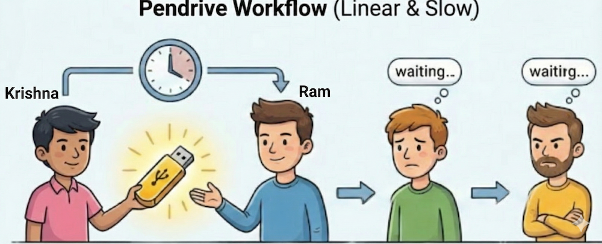
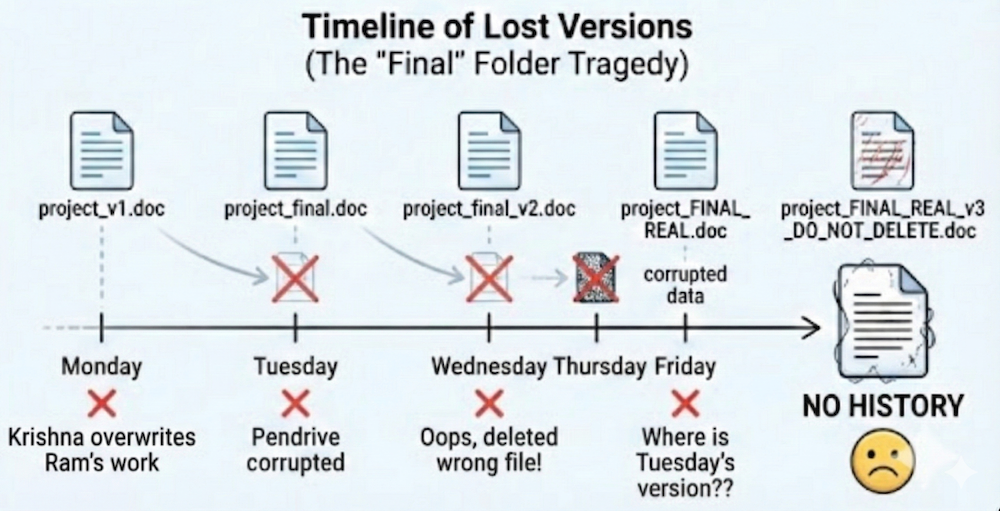
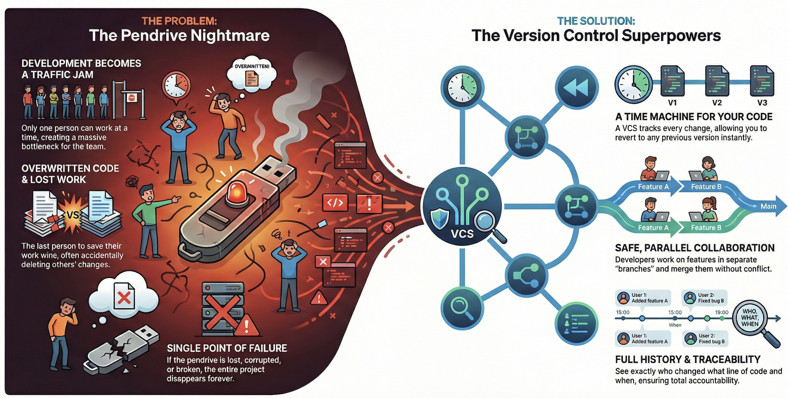

Imagine a world without Git. Two developers share one codebase, and the only copy of the "working" code lives on a ~1GB pendrive.

There is no cloud repository. There is only `The Pendrive`. If you want to change the code, you need The Pendrive. If you have The Pendrive, you hold the power. If you don't? You wait.

This was a reality for many teams in the 90s, and every problem it caused is something version control was built to fix.

> With one shared copy of the code, whoever saves last wins.

Let's walk through one Tuesday of the "Pendrive Workflow", and then see what version control changes.

---

## Only One Person Can Work at a Time

Here is a standard Tuesday for a team of two developers, `Krishna` and `Ram`, without version control.

`09:00 AM:` Krishna grabs The Pendrive. He copies the code to his laptop to fix a critical login bug.

`09:30 AM:` Ram needs to work on the payment gateway. He asks Krishna for the drive.

`The Bottleneck:` Krishna shouts, _"I'm not done! If you take it now, the code is broken!"_ Ram has to sit there and spin around in his chair, because he literally cannot code until Krishna is finished.

Development isn't parallel; it's `serial`. It's a traffic jam where only one car can move at a time.

### The "Final_Final_v2" Tragedy

Krishna is taking his sweet time, so Ram gets frustrated. He decides to work on an old copy of the code he saved on his desktop last week, and writes brilliant code for three hours.

Finally, he gets The Pendrive. He opens the folder to save his work and sees this:

> `Project_Source_Code` -> `Project_Source_Code_Final` -> `Project_Source_Code_Final_FINAL` -> `Project_Source_Code_Final_v2_DO_NOT_DELETE`

Which one is the real one? Who knows!

Ram guesses. He copies his files onto the drive. `Disaster strikes.`

Because Ram was working on an old version, he just overwrote the bug fix Krishna spent all morning writing. Krishna's code is gone. There is no `Ctrl+Z` for a file replacement on a USB stick.

## The Last Person to Save Wins

In Git, if you and I change the same line of code, Git stops us with a merge conflict and makes us decide which code wins.

With the pendrive? `The last person to save wins.`
If I fix a bug, and you upload a file you worked on yesterday that _doesn't_ have the fix, my bug comes back from the dead. This leads to the infamous "I swear I fixed this yesterday!" conversation.

## There Is No Undo

Beyond overwriting work, relying on a physical device adds physical risks:

- **No History:** If the code breaks today, you can't go back to how it looked yesterday.
- **Corruption:** If the pendrive is lost, corrupted, or washed in a pair of jeans, the entire project is gone.

Eventually, the software world realized this was unsustainable. Teams needed a way to work at the same time, keep a history of every change, and never lose work to whoever saved last. That need gave birth to `Version Control Systems (VCS)`.

---

## Version Control Is a Time Machine for Code

A `Version Control System (VCS)` is software that records every change to a project, so developers can store versions, compare them, and go back when something breaks.

Think of it as a `Time Machine` for your code. Every change to every file is tracked, so you can return to any earlier version, and several people can work on the same project without overwriting each other. (1)

### What Changes for Krishna and Ram

- **History Tracking:** Every change is recorded. You can see exactly who changed which line, and when. (No more blaming the wrong person!)
- **Branching and Merging:** Developers create "branches" (parallel universes) to work independently. Ram works on payments while Krishna works on login, and they merge later without overwriting each other.
- **Traceability:** Changes can be linked to specific issues or features, so you can see why the code evolved the way it did.
- **Safety:** Every change can be reviewed before it's merged, which means fewer broken builds.

---

The pendrive had one copy of the truth, and whoever saved last owned it. Version control gives everyone their own copy, a full history, and a way to merge, so nobody's Tuesday morning of work disappears again.

Next in the series: [Git for Beginners: Essential Commands You Need to Know](/blog/git-essentials).

---

_(1)_ Reference: [GitLab - What is Version Control?](https://about.gitlab.com/topics/version-control/)
