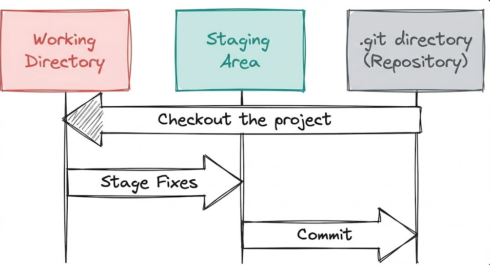
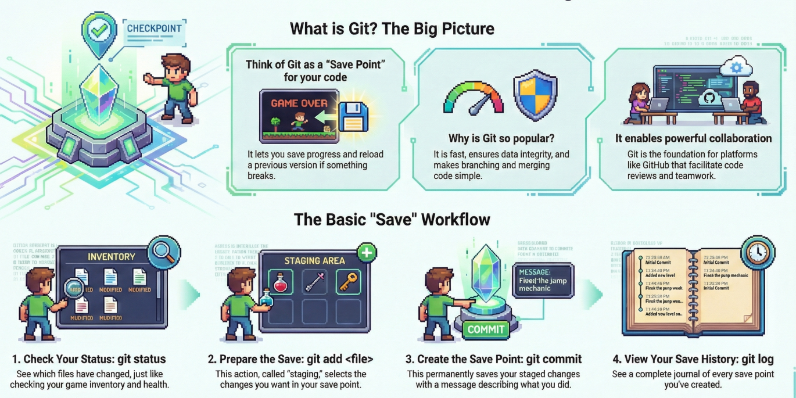

If you have ever played a video game, you know the anxiety of facing a difficult boss. What is the first thing you do before walking through that boss door? You save your game.

Why? Because if you rush in and lose all your health, you don't want to restart the entire game from level one. You want to respawn right where you were, with all your items and progress intact.

> `Git` is a save button for your code.

It lets you create Save Points in your project. If you write a bunch of code and accidentally break your entire app, you don't have to panic. You "reload" your last save, and you are back in business.

In this post, we'll go through the Git basics as a game: what Git is, the terms you'll keep hearing, and the six commands that take you from a new project to your first save.

## What Git Is

Git is a distributed version control system: every developer's machine holds a complete copy of the repository, history included. You commit your changes locally, test them, and sync with a remote repository (like GitHub) when you're ready.

### Snapshots, Not Lists of Changes

The major difference between Git and most other version control systems is the way Git thinks about data. Most version control systems store information as a list of file-based changes (deltas). Git instead stores a snapshot of your whole project every time you commit; files that didn't change aren't copied again, Git just points to the version it already has.

That design is why Git gives you:

1. **Distributed Development**: Every developer has a full copy of the repository, including its history, so you can work offline and browse history instantly.
2. **Branching and Merging**: Creating a branch for a feature or bug fix is cheap, and merging it back is straightforward.
3. **Pull Requests and Code Reviews**: Platforms like GitHub and GitLab build collaboration on top of Git with pull requests and code reviews.
4. **Data Integrity**: Every file and commit is checksummed with a SHA-1 hash, so any corruption is detected.
5. **Speed**: Most operations run locally, so committing, branching and merging are fast.

### Core Terms in Git

1. **Repository (Repo)**: A directory that contains your project files and the entire history of changes made to them. You push it to a remote server like GitHub or GitLab.
2. **Branch**: A separate line of development. You create branches to work on features or bug fixes without affecting the main codebase.
3. **Commit**: A "Save Point". Each commit has a unique ID and a message describing the changes.
4. **Stage**: Choosing which changes go into your next commit.
5. **HEAD**: The "You are here" marker: which Save Point (commit) you're currently playing.

It's also important to understand `The Three States` a file can be in:

1. **Modified**: The file has changed, but the change isn't committed yet.
2. **Staged**: The change is marked to go into the next commit. Only staged changes are included.
3. **Committed**: The change is saved in the repository.



## Your First Save Point, Step by Step

1. Start a New Game with `git init`: This creates a new Git repository in your project directory.

```
mkdir git-game
cd git-game
git init
```

2. Check your status with `git status`: This shows the current state of your repository, including changes that aren't committed yet. It's like checking your inventory and health.

```
git status
```

3. Create Content - Create a file named story.txt and type "Chapter 1: The Hero Wakes Up." If you run `git status` now, the file shows in red. Git sees a new file, but it isn't prepared to be saved yet.

4. Prepare the Save - `git add`
   In a game, you might organize your inventory before saving. In Git, this is called Staging. We tell Git which files go into the save.

```
git add story.txt
```

:::tip
Type `git add .` to add EVERYTHING that changed at once.
:::

Run `git status` again. The file turns green. It is now "Staged" and ready to be committed.

5. Create the Save Point - `git commit`
   This is the moment you actually press "Save". Leave a message so you remember why you saved here.

```
git commit -m "Started the story with Chapter 1"
```

Success! You have a permanent checkpoint. You can now delete story.txt, change it, or break it, and you can always return to this exact state.

6. View Your Saves - `git log`
   Want to see your list of save points?

```
git log
```

This prints a journal of every save: who made it, when, and the message they left.

---



Git lets you make mistakes, and in programming, making mistakes is how you learn. So save before the boss fight: commit before the risky refactor, then go ahead and break things.

Next in the series: [Inside Git: How It Works Under the Hood](/blog/inside-git).
