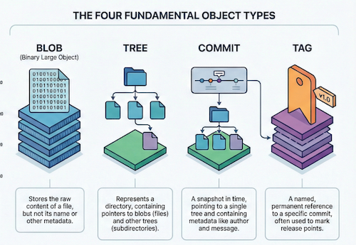
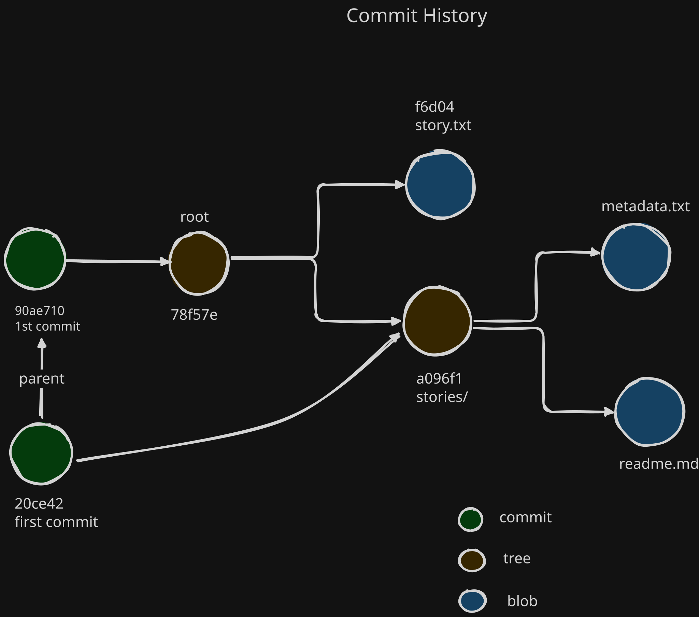
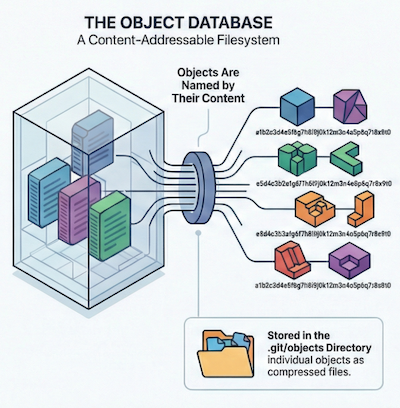

Commit a project with three files. Change one line in one of them and commit again.

You might expect Git to have stored the project twice. It didn't. The second commit added three small objects: the new version of the file that changed, a new list of the root folder, and the commit itself. Everything else, including a whole subfolder, is shared between both commits.

> Git names everything by the hash of its content, so identical content is only ever stored once.

In the [previous post](/blog/git-essentials) we used Git through its commands. This post opens the `.git` folder: the four object types Git stores, what happens inside it during two real commits, and what the rest of the folder is for.

## Four Object Types Store Everything

Git is a `content-addressable file system`. All data is stored as objects, and each object is identified by the **SHA-1 hash** of its content. Git doesn't track individual file edits; it stores snapshots of your project's directory structure, built from four object types:

- **Blobs (Binary Large Objects):** These store the `actual content of a file`. A blob doesn't store metadata like the file name or permissions; it's purely the data. If two files have identical content, even in different locations or commits, they **share the same blob object**.
- **Trees:** These represent `directories`. A tree stores file modes (permissions), object types (blob or another tree), SHA-1 references and **file names**. A root tree points to blobs (files) and other trees (subdirectories).
- **Commits:** These represent a `specific version or snapshot` of the project. A commit points to a root tree and stores the author, committer, date and message. Crucially, it also references its **parent commits**, which makes the history a directed acyclic graph (DAG).
- **Tags:** These give a permanent name to a specific commit, often used for version releases.



## Watching Git Store Two Commits

Let's see these objects for real. We'll create a repository, make two commits, and "X-ray" the `.git` folder after each one.

### The Setup

We start with a simple project structure:

```
project/
├── story.txt
└── stories/
    ├── metadata.txt
    └── readme.md
```

We initialize the repository, which creates the hidden `.git` directory: the database where all our objects will live.

```bash
❯ git init

> Initialized empty Git repository in /path/to/project/.git/
```

### The Staging Area (The Index)

Before we commit, we must add files.

```bash
❯ git add .   # adds all files to the staging area
```

What just happened internally? Git isn't just listing filenames. It takes the content of every file, compresses it into a blob, hashes it, and stores it in `.git/objects`. The index (staging area) is a draft manifest that maps your filenames to those blob hashes: the next tree, under construction.

### Commit 1: The Initial Snapshot

We commit our work:

```bash

❯ git commit -m "first commit"
> [main (root-commit) 90ae710] first commit
> 3 files changed, 3 insertions(+)
>  create mode 100644 stories/metadata.txt
>  create mode 100644 stories/readme.md
>  create mode 100644 story.txt
```

Now let's play detective. We have a commit hash (90ae710). `git cat-file -p` (pretty print) shows what's inside any object:

```bash
❯ git cat-file -p 90ae710

tree 78f57e9cce76cd70270e8e678fe13166c6aa3874
author  <author> 1768598520 +0100
committer <author> 1768598520 +0100

first commit
```

The commit object is tiny. It holds metadata (author, time) and a single pointer to a root tree (78f57e9).

Let's look inside that root tree:

```bash

❯ git cat-file 78f57e9 -p
040000 tree a096f175360d158908baf1f8c25378635e90e9ea	stories
100644 blob f6d043db0fd669f2d8685b634b662e39fdacaf12	story.txt
```

This tree represents our project root. It points to one blob (story.txt) and another tree (the stories folder). If we follow the stories tree (a096f1), we find the blobs for metadata.txt and readme.md:

```bash

❯ git cat-file a096f1 -p
100644 blob f6d043db0fd669f2d8685b634b662e39fdacaf12	metadata.txt
100644 blob 8728a858d9d21a8c78488c8b4e70e531b659141f	readme.md
```

Look at the hashes. `story.txt` and `stories/metadata.txt` both point to blob **f6d043**. They're different files in different folders, but they have the same content, so Git stored that content once.

### Commit 2: The Evolution (The DAG)

Now, let's modify story.txt and commit again.

```bash
❯ echo "Additional content" >> story.txt
❯ git add .
❯ git commit -m "second commit"
[main d61c92a] second commit
 1 file changed, 1 insertion(+)
```

The log shows a linear history:

```bash
❯ git log --oneline

d61c92a (HEAD -> main) second commit
90ae710 first commit
```

But the internal structure is more interesting. Let's inspect the second commit (d61c92a):

```bash
git cat-file d61c92a -p
tree 20ce426f8e3fdd9f1fd72813fa6674113df20781
parent 90ae71002a1512aa87565bead79f205a3469f58d

second commit
```

### Unchanged Content Is Reused, Not Copied

Git created a new blob for the modified story.txt and a new root tree to list it. Now look at the `stories` directory. We didn't touch it, so its content didn't change, so its hash didn't change. Git doesn't make a copy; the new root tree simply points to the existing `stories` tree from the first commit.

That's the opening of this post in practice: one changed file cost one new blob, one new tree and one commit object. This is also where the "graph" in DAG comes from: commits point to their parents, and trees from different commits point to the same objects.



## The .git Folder Is the Repository

Your project files are just one checked-out version. The repository itself, every version of every file, lives in `.git`:

- **HEAD:** points to the current branch reference, i.e. which branch is checked out.
- **config:** repository-specific configuration settings.
- **refs:** references to branches and tags. A branch is just a file containing a commit hash.
- **objects:** every blob, tree, commit and tag, compressed.
- **index:** the staging area, the draft of your next tree.



---

Git looks like a set of commands, but underneath it's a small database where every object is named by its content. That's why it's fast (most work is local), why its history can't be silently altered (change a byte and the hash changes), and why committing a one-line change to a large project costs almost nothing.
