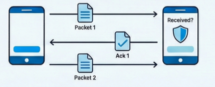
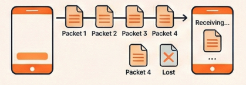

Before your browser sends a single byte of a webpage request over TCP, it has already waited a full round trip to the server just to set up the connection. A DNS lookup over UDP doesn't wait at all: one packet goes out, one packet comes back.

That difference is the whole story of TCP and UDP.

> TCP pays up front for guarantees. UDP skips the guarantees to go fast.

Both protocols move data from point A to point B. This post covers how each one works, what they cost, how to pick between them, and where HTTP fits in.

## TCP: Every Byte Arrives, in Order

TCP (Transmission Control Protocol) is the reliable workhorse of the internet. Think of it like sending a registered letter: you know it will arrive, you'll get a confirmation, and the pages will be in the right order.

Before any data is sent, TCP sets up a connection with a [three-way handshake](/blog/tcp-3-way-handshake): the two computers introduce themselves and agree to talk. Then your data is split into packets. The receiver sends back acknowledgments ("got packet 1", "got packet 2"), and if a packet goes missing, TCP notices and sends it again.

That reliability costs time: a round trip before the first byte, and waiting whenever something has to be resent. For most internet activities (loading websites, sending emails, downloading files) you want that reliability anyway.

## UDP: Fire and Forget

UDP (User Datagram Protocol) is more like shouting across a crowded room: fast, but with no guarantee anyone heard you.

With UDP, packets are simply sent to their destination with no handshake, no acknowledgments and no guarantees. Packets might arrive out of order, get lost, or arrive twice, and UDP doesn't care. It just keeps sending.

That sounds terrible, but for some applications, late data is worse than lost data. A few dropped packets in a video call or online game barely show. Waiting for them to be resent shows up as lag.

## TCP vs UDP at a Glance

| TCP | UDP |
| --- | --- |
| Requires a connection (handshake) | No connection needed |
| Guarantees delivery | No guarantee |
| Packets arrive in order | Packets may arrive out of order |
| Slower (handshake, acknowledgments, resends) | Faster (minimal overhead) |
| Header: at least 20 bytes | Header: 8 bytes |
| Extensive error checking | Basic error checking |
| When accuracy matters | When speed matters |

## Pick by What Hurts More: Lost Data or Late Data

Use TCP when losing data is worse:

-   Accuracy is critical – file transfers, emails, web browsing
-   Order matters – loading a webpage, downloading software
-   You can't afford lost data – bank transactions, text messages

**Examples:** HTTP/1.1 and HTTP/2 (websites), video on demand (Netflix and YouTube stream over HTTP), SMTP (email), SSH (remote access), FTP (file transfer)

Use UDP when late data is worse:

-   Speed matters more than perfection – live calls, gaming
-   Losing a little data is acceptable – a dropped video frame or a moment of audio
-   Real-time matters – DNS lookups, online multiplayer games

**Examples:** Voice and video calls (Zoom, Discord, WebRTC), online gaming, DNS queries, HTTP/3 (built on QUIC, which runs over UDP)

Think of a live video call: if a few frames drop, you barely notice. If the protocol paused the call to resend them, everyone would see the picture freeze.

## HTTP Rides on TCP

HTTP (Hypertext Transfer Protocol) is the language of the web: it's how your browser asks for a page and how the server sends it back. But HTTP doesn't deliver anything itself. It relies on a transport protocol underneath, and for most of the web that's TCP.

Think of it like this:

-   **HTTP** is the _language_ being spoken ("Please send me the homepage")
-   **TCP** is the _delivery service_ that makes sure the message gets there reliably

When you type a URL in your browser:

1.  Your browser uses HTTP to format the request
2.  TCP breaks that request into packets and sends them
3.  TCP makes sure all packets arrive at the server
4.  The server uses HTTP to format its response
5.  TCP delivers that response back to you, in order and complete

This is why HTTP is called an "application layer" protocol: it sits on top of TCP (the "transport layer"). HTTP handles _what_ you're communicating; TCP handles _how_ it gets there.

:::note
HTTPS adds encryption on top of the same stack. The newest version, HTTP/3, swaps TCP for QUIC, a protocol built on UDP that adds its own reliability, to avoid some of TCP's waiting.
:::

---

So the next time a page loads or a call stutters, you know which trade was made: TCP waited to get every byte right, and UDP chose not to wait at all.

More posts on [networking](/blog/tags/networking/).
