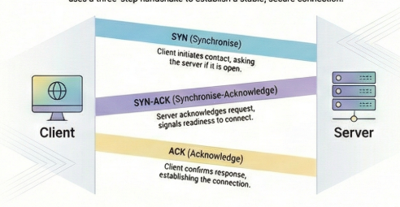

### What is TCP and why it is needed

**TCP (Transmission Control Protocol)** is one of the core protocols of the Internet Protocol Suite. It operates at the Transport Layer (Layer 4) and provides a reliable, ordered, and error-checked delivery of data between applications running on networked devices.

Think of TCP as a postal service with tracking and confirmation. When you send a package, you want to know:

-   Did it arrive?
    
-   Did it arrive intact?
    
-   Did it arrive in the right order (if you sent multiple packages)?
    

TCP provides these guarantees for data packets traveling across the internet. Without TCP, applications like web browsers, email clients, file transfers, and SSH connections wouldn't work reliably.

**Why TCP is needed:**

-   The underlying Internet Protocol (IP) is **unreliable** - packets can be lost, duplicated, delayed, or arrive out of order
    
-   Applications need a **reliable communication channel** without worrying about the chaos of the underlying network
    
-   Developers need a **simple interface** - they can write data to a stream and trust it will arrive correctly
    

* * *

### Problems TCP is Designed to Solve

| **Problem** | **Description** | **TCP's Solution** |
| --- | --- | --- |
| **Packet Loss** | Networks are unreliable. Packets can be dropped due to network congestion, router failures, or buffer overflows. | Acknowledgments (ACKs) and retransmissions. The sender retransmits data if it doesn't receive an acknowledgment within a timeout period. |
| **Out-of-Order Delivery** | Packets can take different routes through the network and arrive in a different order than they were sent. | Sequence numbers. Each byte of data is numbered, allowing the receiver to reorder packets correctly. |
| **Data Corruption** | Bits can be flipped during transmission due to electrical interference or hardware issues. | Checksums. TCP includes a checksum in every segment to detect corrupted data. |
| **Duplicate Packets** | Network devices might accidentally send the same packet multiple times. | Sequence numbers help identify and discard duplicate packets. |
| **Flow Control** | A fast sender can overwhelm a slow receiver. | Sliding window mechanism that allows the receiver to tell the sender how much data it can handle. |
| **Congestion Control** | Too many senders can overwhelm the network itself. | Congestion control algorithms (like Slow Start, Congestion Avoidance) that detect network congestion and reduce sending rates. |

### Step-by-step working of SYN, SYN-ACK and ACK

Imagine you're trying to start a phone conversation with a friend:

**You:** "Hey, can you hear me?" (This is the **SYN** - you're initiating contact)  
**Friend:** "Yes, I can hear you! Can you hear me?" (This is the **SYN-ACK** - they acknowledge hearing you AND check if you can hear them)  
**You:** "Yep, I hear you too!" (This is the **ACK** - you confirm you received their response)

Now you both know the line is working in both directions, and you can start your actual conversation.

If we translate this into technical -

**Step 1: SYN (Synchronize)**

-   Client sends a TCP segment with the **SYN flag** set
    
-   Includes an **initial sequence number (ISN)** - let's say `seq=1000`
    
-   This says: "I want to establish a connection, and my starting sequence number is 1000"
    

**Step 2: SYN-ACK (Synchronize-Acknowledge)**

-   Server receives the SYN
    
-   Server responds with **both SYN and ACK flags** set
    
-   Sends its own initial sequence number - say `seq=5000`
    
-   Acknowledges the client's sequence number: `ack=1001` (client's seq + 1)
    
-   This says: "I received your request, my starting sequence number is 5000, and I'm expecting your next byte to be 1001"
    

**Step 3: ACK (Acknowledge)**

-   Client sends an ACK back to the server
    
-   `seq=1001` (as expected by the server)
    
-   `ack=5001` (server's seq + 1)
    
-   This says: "I received your response, and I'm expecting your next byte to be 5001"
    

**Connection is now ESTABLISHED!** Both sides have synchronized their sequence numbers and are ready to exchange data.



#### Data Transfer in TCP

TCP breaks data into **segments**, each with a sequence number. The sender transmits segments, and the receiver acknowledges them.

**Example:** You send "Hello World" (11 bytes)

-   TCP breaks it into segments: `[SEQ=1, "Hello"]` and `[SEQ=6, " World"]`
    
-   Receiver gets segment 1 → sends `ACK=6` (expecting byte 6 next)
    
-   Receiver gets segment 2 → sends `ACK=12`
    

### How TCP Ensures Reliability, Order & Correctness

| Mechanism | How It Works |
| --- | --- |
| **Sequence Numbers** | Each byte gets a number. Receiver reorders out-of-order packets. |
| **Acknowledgments (ACKs)** | Receiver confirms receipt. Missing ACK triggers retransmission. |
| **Checksum** | Detects corrupted data. Bad packets are discarded and resent. |
| **Retransmission Timer** | If no ACK arrives in time, sender resends the segment. |
| **Flow Control** | Receiver advertises window size to prevent overwhelming it. |

### TCP Connection Termination

Either side can initiate closing. It uses **FIN** (finish) flags.

```
    Client                    Server
       |                         |
       |-------- FIN ----------->|   1. Client: "I'm done sending"
       |<------- ACK ------------|   2. Server: "Got it"
       |                         |
       |<------- FIN ------------|   3. Server: "I'm done too"
       |-------- ACK ----------->|   4. Client: "Got it, closing"
       |                         |
    CLOSED                    CLOSED
```

**Example:** Closing an HTTP connection

1.  Browser finishes request → sends **FIN**
    
2.  Server acknowledges with **ACK**
    
3.  Server finishes response → sends its **FIN**
    
4.  Browser sends final **ACK** → both sides close
    

The client then enters a **TIME\_WAIT** state (typically 2 minutes) to handle any delayed packets before fully closing.

### Conclusion

-   TCP (Transmission Control Protocol) is a fundamental protocol of the Internet Protocol Suite that ensures reliable, ordered, and error-checked data delivery between applications on networked devices.
    
-   It overcomes issues such as packet loss, out-of-order delivery, data corruption, duplicate packets, and congestion through mechanisms like acknowledgments, sequence numbers, checksums, and congestion control algorithms.
    
-   TCP also involves a three-step process (SYN, SYN-ACK, ACK) to establish connections and ensures orderly data transfer with its sequence and acknowledgment features.
    
-   Lastly, it provides a structured method for connection termination using FIN and ACK flags.
    

If you find this blog interesting, feel free to share it across. Follow me on [LinkedIn](https://www.linkedin.com/in/vibhavari-bellutagi/)
