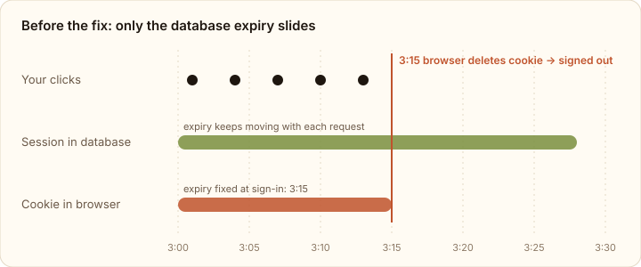
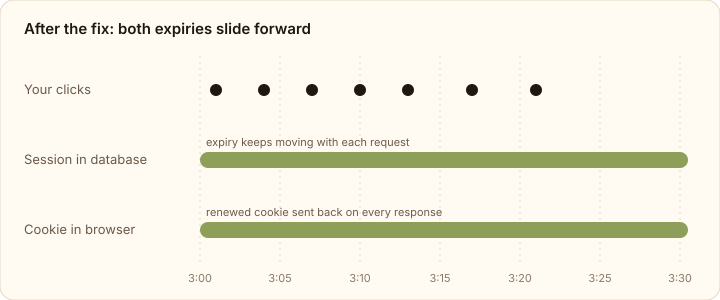

I was demoing [Move](/#work), the gym management app I'm building, and got kicked back to the sign-in page three times in 40 minutes. I wasn't idle. I was clicking through bookings, opening member profiles, presenting the whole time.

The app has a deliberate security rule: **stay active and you stay signed in; go idle for 15 minutes and you're signed out.** What I got instead was "signed out roughly every 15 minutes, no matter what you're doing".

This post walks through why that happened with [Better Auth](https://www.better-auth.com/) and [tRPC](https://trpc.io/), the one-line cause, and the fix. If your users are being logged out while they're active, this is worth checking first.

:::tldr
**Problem:** users were signed out every 15 minutes, even while active. Better Auth extended the session in the database, but the renewed cookie never reached the browser, so it expired at its original time.

**Fix:** call `auth.api.getSession` with `returnHeaders: true` and forward every `Set-Cookie` header onto your HTTP response.
:::

## The setup: a sliding 15-minute session

Move uses Better Auth for authentication and tRPC on Express for the API. The session config looks like this:

```ts
session: {
  expiresIn: 15 * 60, // session lives 15 minutes...
  updateAge: 60,      // ...pushed forward on use, at most once a minute
  cookieCache: {
    enabled: true,
    maxAge: 5 * 60,   // trust the signed cookie for 5 min, skip the DB
    strategy: "jwe",
  },
},
```

This is a **sliding session**. Each authenticated request (more than `updateAge` after the last refresh) pushes the session's expiry to "now + 15 minutes". Someone who keeps working never expires; someone who walks away is signed out 15 minutes after their last request.

That's the theory. In practice, "signed in" is recorded in two places, and both have to agree.

## Logged in lives in two places

Think of a gym membership:

- **The register (the database).** A session row that says "this session is valid until 3:15pm". The server owns it and can extend it whenever it likes.
- **The membership card (the browser cookie).** The `session_token` cookie the browser sends with every request. It has its own expiry printed on it, set when you signed in. When that time passes, the browser throws the card away on its own. The server can't stop that.

Sliding sessions only work if **both** get a fresh 15 minutes on every request. Extend the register but not the card, and the browser deletes the card at the original time while the database still thinks you're signed in.

That's exactly what happened.

## What was going wrong

Every tRPC procedure that needs a user goes through one middleware, `protectedProcedure`. Before the fix, it looked like this:

```ts
export const protectedProcedure = t.procedure.use(async (options) => {
  const { ctx } = options;
  const result = await auth.api.getSession({ headers: ctx.headers });
  if (!result) throw customTrpcError.unauthorized("Not authenticated");

  return options.next({ ctx: { ...ctx, user: result.user, session: result.session } });
});
```

It looks correct, and it mostly is. `auth.api.getSession` validates the cookie, and when the session is due for a refresh, Better Auth extends `expiresAt` in the database and prepares a `Set-Cookie` header with the renewed cookie.

But this is a **server-side call**, not a request going through Better Auth's own HTTP handler. Better Auth has no access to your Express response object here. It can only *return* those headers, and only if you ask for them. We didn't, so the renewed cookie was thrown away and the response went back to the browser with data and no new cookie.



So the database said "valid until 3:28" while the browser had already deleted its cookie at 3:15. The next request arrived with no cookie, and the user landed on the sign-in page.

### Why it didn't happen every time

One thing *did* renew the cookie: the client's "am I still signed in?" check, which calls Better Auth's `/get-session` endpoint through its own handler when a page loads or the window regains focus. That response does carry `Set-Cookie`.

That's why the bug was easy to miss in development. Switching tabs, reloading or opening devtools quietly renewed the cookie. Working on a single tab, which is how most people actually use an app, almost never triggers it.

:::tip
If logouts seem random and "go away when I debug", look for anything that renews the session as a side effect of focus or reload. It can hide a cookie that never gets renewed on normal API calls.
:::

## Fix option A: make the timeout longer (rejected)

The tempting fix is `expiresIn: 60 * 60`. It would have made the complaints stop, but:

- Active users would still be logged out, every hour instead of every 15 minutes.
- It breaks the security requirement that idle sessions end after 15 minutes.

It hides the bug instead of fixing it. The question was never "how long should the timeout be"; it was "why isn't activity counting".

## Fix option B: send the renewed cookie back to the browser

Better Auth supports this directly: pass `returnHeaders: true` to `getSession`, and it returns the headers alongside the session. The job is then to get those `Set-Cookie` headers onto the HTTP response.

There were two ways to build that.

**B1: a separate middleware before every request** that calls `getSession` only to refresh the cookie. It's a small change, but every request then looks up the session twice: once in the new middleware and once in `protectedProcedure`. When the 5-minute cookie cache expires and a page fires 10 tRPC calls in parallel, that's around 20 database lookups instead of 10.

**B2: do it in the check that already exists.** `protectedProcedure` already calls `getSession` once per request, so let it also forward the cookies. Same number of lookups as before.

I went with B2. The production change is small; most of the work was in tests (more on that below).

## The fix

First, give the tRPC context a way to add cookies to the Express response:

```ts
export interface TRPCContext {
  headers: Headers;
  /** Queues a Set-Cookie on the HTTP response. Absent for callers with no response (tests). */
  appendSetCookie?: (cookie: string) => void;
}

export async function createContext({ req, res }: CreateExpressContextOptions) {
  return {
    headers: fromNodeHeaders(req.headers),
    appendSetCookie: (cookie) => {
      res.append("Set-Cookie", cookie);
    },
  };
}
```

Then ask `getSession` for its headers and forward every `Set-Cookie`:

```ts
export const protectedProcedure = t.procedure.use(async (options) => {
  const { ctx } = options;
  const { headers: sessionHeaders, response: result } = await auth.api.getSession({
    headers: ctx.headers,
    returnHeaders: true,
  });

  // Better Auth slides the session forward on use and hands back the renewed cookies.
  // They must reach the browser, or its cookie keeps the expiry from sign-in.
  for (const cookie of sessionHeaders.getSetCookie()) ctx.appendSetCookie?.(cookie);

  if (!result) throw customTrpcError.unauthorized("Not authenticated");

  return options.next({ ctx: { ...ctx, user: result.user, session: result.session } });
});
```

Three details matter here:

1. **Use `res.append`, not `res.setHeader`.** Better Auth can send more than one cookie (the session token and the cookie cache). `setHeader` would overwrite the first with the second.
2. **Use `getSetCookie()`, not `get("set-cookie")`.** The `Headers.get` method joins multiple `Set-Cookie` values with commas, and cookie expiry dates contain commas. `getSetCookie()` returns them as a proper array.
3. **Forward cookies before the unauthorized check.** If the session has expired, Better Auth may send headers that clear the stale cookie. Those should reach the browser even when the request is rejected.



Now every authenticated request refreshes both the register and the card. Keep working and you stay signed in. Walk away and the cookie expires 15 minutes later, as the security rule intended.

## Try it yourself: before and after the fix

Here's a small simulation of the two versions. Keep pressing "Make a request" like a busy user and watch when you get signed out. Then switch to "After the fix" and do the same, or start the clock and stay idle.

::demo[session-simulator]

## The cost: 468 test mocks

The production diff was a few lines. The test diff was not.

The API tests mocked `auth.api.getSession` to return a session directly. With `returnHeaders: true`, it now returns `{ headers, response }`, so 468 mocks needed the new shape. I added a small test helper that builds it, and the changes were mechanical.

I also added two tests that prove the renewed cookie is forwarded to the response, including when the request is rejected as unauthorized. All 686 tests pass.

:::note
The `appendSetCookie` function is optional in the context type on purpose. Server-side callers and tests that create a context without an HTTP response still work; the cookie is simply not forwarded.
:::

## How to check it yourself

If you use Better Auth's server API inside your own framework (tRPC, Express routes, Hono, Next.js server actions), check this:

1. **Sign in and keep working for 20+ minutes** on one tab, without reloading or switching tabs. You should stay signed in.
2. **Sign in and do nothing for about 20 minutes.** You should be signed out.
3. **In devtools, watch the Network tab.** Authenticated API responses should include a `Set-Cookie` for the session token every so often, with a later expiry each time.

Why about 20 minutes and not exactly 15? With `cookieCache` enabled, Better Auth trusts the signed cookie for up to 5 minutes without checking the database, so the idle logout can land up to 5 minutes late. That's a deliberate trade-off between database load and timing precision. The same lag applies to revoking a session.

## Frequently asked questions

### Why does Better Auth log users out even when they're active?

The usual cause is a session that's extended in the database but not in the browser. If you call `auth.api.getSession` on the server without `returnHeaders: true` and without forwarding the `Set-Cookie` headers, the browser cookie keeps the expiry it got at sign-in and is deleted when that time passes.

### What do `expiresIn` and `updateAge` do in Better Auth?

`expiresIn` is how long a session lasts after it was last refreshed. `updateAge` is how often it gets refreshed: once a request arrives more than `updateAge` after the last refresh, the expiry is pushed to "now + `expiresIn`". Together they make a sliding session.

### Is increasing `expiresIn` a valid fix?

Only if your requirements allow a longer session. It doesn't fix the cause; active users still get logged out, just less often.

### Does this affect Next.js, Hono or plain Express too?

Any time you call `auth.api.getSession` (or other `auth.api` methods that change cookies) yourself, rather than through Better Auth's own request handler, the renewed cookie only reaches the browser if you forward the returned headers. How you forward them depends on your framework.

## Wrapping up

The bug wasn't in Better Auth or in the session settings. It was in the space between them: the server did its part, prepared the renewed cookie, and my code dropped it on the floor.

If your sliding sessions behave like fixed ones, look at what happens to the `Set-Cookie` headers from `getSession`. Mine were going nowhere.

I'm writing more about problems I run into while building Move and other apps. You can find them under [Building Apps](/blog/tags/building-apps/).
